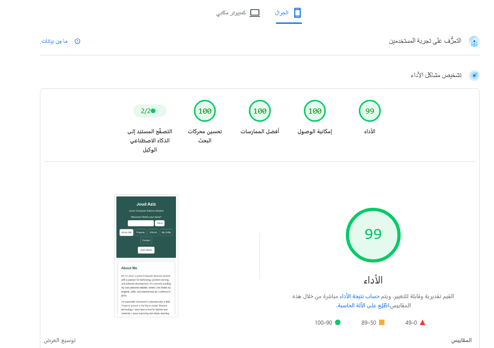
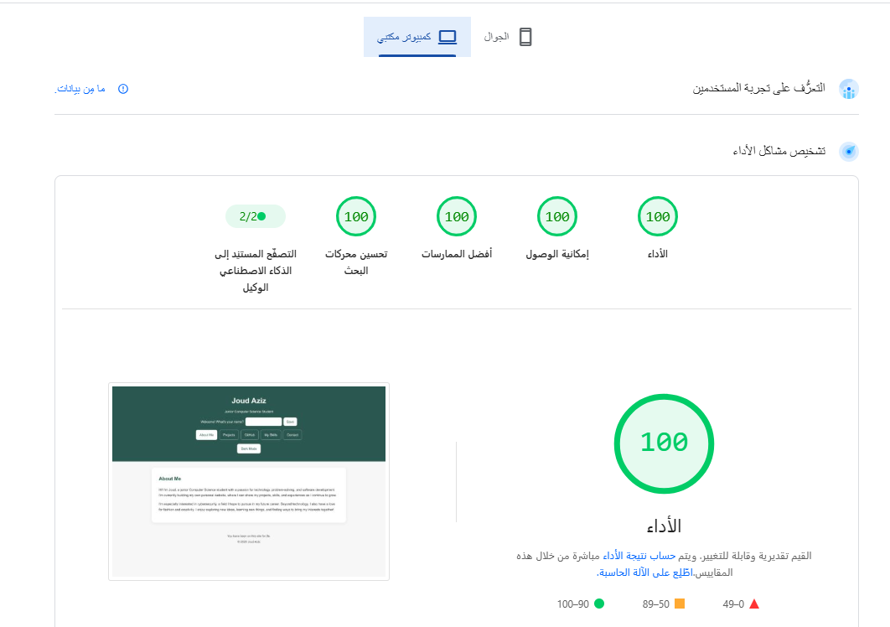

# Joud Aziz — Personal Portfolio (Assignment 3)

A personal portfolio website built with **HTML, CSS, and JavaScript**. It introduces me as a junior Computer Science student and shows my projects, skills, and contact information.

Assignment 3 builds on Assignments 1 and 2 and adds **advanced features**: live data from the GitHub API, project filtering and sorting, saved user preferences, a validated contact form, and a visit timer.

🔗 **Live website:** https://joudaziz612.github.io/202338270-joudaziz-assignment3/

---

## ✨ Features

| Feature | What it does |
|---|---|
| **GitHub API integration** | Loads my portfolio assignment repositories live from GitHub. Shows a friendly error message and a **Try Again** button if loading fails. |
| **Filter + sort projects** | Filter projects by **category** and **level** at the same time, then sort them by **newest**, **oldest**, or **name**. Shows a message when nothing matches. |
| **Level messages** | Choosing *Beginner* or *Advanced* shows a different message that explains that group of projects. |
| **Visitor greeting** | Visitors can save their name. The site greets them by name and by time of day (morning, afternoon, evening). |
| **Dark / light mode** | The chosen theme is remembered, even after closing the browser. |
| **Remembers last section** | The site reopens on the last section the visitor viewed. |
| **Contact form validation** | Checks every field (name, valid email, message of at least 10 characters), shows errors under each field, and only then prepares the email. Includes a live character counter. |
| **Visit timer** | Shows how long the visitor has been on the site. |
| **Responsive design** | Works on phones, tablets, and desktops. |

---

## 🛠️ Technologies

- **HTML5** — page structure and accessible forms
- **CSS3** — CSS variables, Flexbox, Grid, media queries
- **JavaScript (ES6+)** — `fetch`, `async/await`, `localStorage`, `sessionStorage`, DOM manipulation
- **GitHub REST API** — public repositories data
- **GitHub Pages** — hosting

---

## 📁 Project Structure

```
202338270-joudaziz-assignment3/
├── README.md
├── index.html
├── css/
│   └── styles.css
├── js/
│   └── script.js
├── assets/
│   └── images/          # optimized WebP images + Lighthouse screenshots
├── docs/
│   ├── ai-usage-report.md
│   └── technical-documentation.md
└── .gitignore
```

---

## 🚀 Setup Instructions (Run Locally)

No installation or build tools are needed.

### Option 1: Open the file directly
1. **Download the project**
   - Click the green **Code** button on GitHub → **Download ZIP**, then extract it, **or**
   - Clone it with Git:
     ```bash
     git clone https://github.com/joudaziz612/202338270-joudaziz-assignment3.git
     cd 202338270-joudaziz-assignment3
     ```
2. **Double-click `index.html`** to open it in your browser.

### Option 2: Use Live Server (recommended while editing)
1. Open the project folder in **Visual Studio Code**.
2. Install the **Live Server** extension (by Ritwick Dey).
3. Right-click `index.html` → **Open with Live Server**. The page reloads automatically when you save a file.

> **Note:** An internet connection is needed for the GitHub section, because it loads data from the GitHub API.

---

## 🧭 How to Use the Website

1. **Save your name:** type your name at the top and press **Save**. To change it, press **Change name**.
2. **Move between sections:** use the buttons **About Me**, **Projects**, **GitHub**, **My Skills**, and **Contact**.
3. **Explore projects:** in **Projects**, choose a **Category**, a **Level**, and a **Sort** order. Press **View Details** on a project to see more.
4. **See my GitHub work:** open **GitHub** to see my latest assignment repositories. If they don't load, press **Try Again**.
5. **Switch the theme:** press **Dark Mode** / **Light Mode**. Your choice is saved.
6. **Contact me:** fill in the form and press **Prepare Email**. If something is missing, a message appears under that field. When everything is correct, your email app opens with the message ready to send.

---

## ⚡ Performance

- Images converted to **WebP** and resized: total image size dropped from about **1.2 MB to 140 KB**.
- Images use `loading="lazy"` and have `width`/`height` set, so the page doesn't jump while loading.
- The script uses `defer`, so it doesn't block the page from showing.
- GitHub data is cached for 10 minutes, so the API isn't called again on every click.
- Repeated dark mode rules were replaced with **CSS variables**.

**Google PageSpeed Insights (Lighthouse) results:**

| Device | Performance | Accessibility | Best Practices | SEO |
|---|---|---|---|---|
| Mobile | 99 | 100 | 100 | 100 |
| Desktop | 100 | 100 | 100 | 100 |




---

## 🌐 Browser Compatibility

Tested on the live GitHub Pages website:

| Browser / Device | Result |
|---|---|
| Google Chrome (Windows laptop) | ✅ All features work |
| Microsoft Edge (Windows laptop) | ✅ All features work |
| Safari (iPhone) | ✅ All features work, layout fits the screen |

---

## 🤖 AI Use (Summary)

I used **Claude (Claude Opus 5.5)** as a step-by-step guide during this assignment: to plan the work, generate and explain code for the new features, optimize images, and draft the documentation. I reviewed, tested, and edited everything (for example, I corrected the project dates to the real ones and limited the GitHub list to my assignment repositories).

Full details, the usage log, and my declaration are in [`docs/ai-usage-report.md`](docs/ai-usage-report.md).

---

## 📄 More Documentation

- [Technical Documentation](docs/technical-documentation.md) — how the code works
- [AI Usage Report](docs/ai-usage-report.md) — AI tools, usage log, and declaration

---

## 👩‍💻 Author

**Joud Aziz Alqarni** — Student ID: 202338270
GitHub: [@joudaziz612](https://github.com/joudaziz612)


